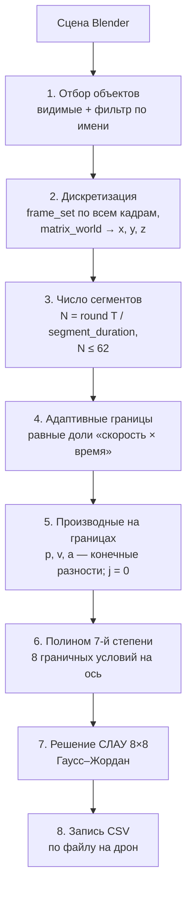

# Crazyswarm2 Blender Exporter

Аддон для Blender, который экспортирует анимацию объектов сцены в CSV-файлы
полиномиальных траекторий формата **[Crazyswarm2](https://github.com/IMRCLab/crazyswarm2)**.
Сначала вы ставите полёт роя дронов Crazyflie как обычную анимацию в Blender, а затем
загружаете полученные файлы на реальные квадрокоптеры.


---

## Оглавление

- [Зачем нужен аддон](#зачем-нужен-аддон)
  - [Проблема](#проблема)
  - [Решение](#решение)
  - [Возможности](#возможности)
- [Установка](#установка)
- [Быстрый старт](#быстрый-старт)
  - [Подготовка сцены в Blender](#подготовка-сцены-в-blender)
  - [Экспорт](#экспорт)
  - [Параметры экспорта](#параметры-экспорта)
  - [Использование в Crazyswarm2](#использование-в-crazyswarm2)
- [Формат выходного файла](#формат-выходного-файла)
- [Алгоритм](#алгоритм)
  - [Общая схема](#общая-схема)
  - [Шаг 1. Отбор объектов](#шаг-1-отбор-объектов)
  - [Шаг 2. Дискретизация анимации](#шаг-2-дискретизация-анимации)
  - [Шаг 3. Выбор количества сегментов](#шаг-3-выбор-количества-сегментов)
  - [Шаг 4. Адаптивная расстановка границ сегментов](#шаг-4-адаптивная-расстановка-границ-сегментов)
  - [Шаг 5. Оценка производных на границах](#шаг-5-оценка-производных-на-границах)
  - [Шаг 6. Построение полинома 7-й степени](#шаг-6-построение-полинома-7-й-степени)
  - [Шаг 7. Решение линейной системы](#шаг-7-решение-линейной-системы)
  - [Шаг 8. Запись CSV](#шаг-8-запись-csv)
  - [Почему именно так](#почему-именно-так)
- [Ограничения и известные особенности](#ограничения-и-известные-особенности)
- [Структура кода](#структура-кода)
- [Автор](#автор)

---

## Зачем нужен аддон

### Проблема

[Crazyswarm2](https://imrclab.github.io/crazyswarm2/) — это ROS 2 стек для управления
роем квадрокоптеров [Crazyflie](https://www.bitcraze.io/). Самый надёжный способ заставить
дрон пролететь сложную траекторию — загрузить её **прямо в память Crazyflie** и запустить
по команде. Встроенный в прошивку планировщик (high-level commander) сам вычисляет
положение, скорость и ускорение в каждый момент и передаёт их регулятору. Поток команд по
радио при этом не нужен, поэтому полёт не страдает от задержек и потерь пакетов.

Прошивка принимает траекторию только в виде **кусочно-полиномиальной функции**:
последовательности сегментов, каждый из которых описан полиномами 7-й степени по `x`, `y`,
`z` и `yaw`. Задать такую траекторию вручную трудно, а для хореографии десятков дронов
практически невозможно.

### Решение

Анимировать движение удобнее всего в 3D-редакторе. В Blender есть ключевые кадры, кривые
(Graph Editor), пути (Follow Path), констрейнты, драйверы, физика, Geometry Nodes, и всё это
сразу видно в 3D-вьюпорте вместе с другими дронами.

Аддон связывает два мира:

1. Вы анимируете объекты-«дроны» в Blender любым способом.
2. Аддон «проигрывает» анимацию кадр за кадром и записывает мировые координаты каждого
   объекта.
3. Записанная траектория разбивается на сегменты и аппроксимируется гладкими полиномами
   7-й степени.
4. Для каждого дрона создаётся отдельный `.csv`, который Crazyswarm2 загружает без
   дополнительной обработки.

### Возможности

- Экспорт **всех дронов сцены за один клик**, по одному CSV на объект.
- Фильтр объектов по подстроке в имени (например, `cf` → `cf1`, `cf2`, `CF_leader`...).
- Учитывается **любой** источник движения: ключевые кадры, родительские связи,
  констрейнты, пути, драйверы. Берётся итоговая мировая матрица объекта.
- **Адаптивная сегментация**: на быстрых участках сегменты короче, на медленных длиннее.
- **Гладкость C³ на стыках**: позиция, скорость, ускорение и рывок непрерывны.
- Соблюдается лимит памяти Crazyflie (не больше 62 сегментов на траекторию).
- Нет внешних зависимостей: весь расчёт написан на чистом Python.

---

## Установка

1. Скачайте файл [`addon.py`](addon.py).
2. В Blender откройте **Edit → Preferences → Add-ons**.
3. В меню (стрелка `⌄` в правом верхнем углу) выберите **Install from Disk...** и укажите
   `addon.py`.
4. Включите галочку у аддона **crazyswarm2 animation (.csv)**.

После этого в меню **File → Export** появится пункт **crazyswarm2 animation (.csv)**.

> Аддон собран под Blender 5.1 (`bl_info["blender"] = (5, 1, 1)`). Он использует только
> стабильные API (`ExportHelper`, `Operator`, `scene.frame_set`, `matrix_world`), поэтому,
> скорее всего, работает и в других версиях 4.x/5.x, но проверялся только на указанной.

---

## Быстрый старт

### Подготовка сцены в Blender

1. **Единицы измерения.** 1 единица Blender = 1 метр. Оси совпадают с системой координат
   Crazyswarm2 (правая, `Z` вверх), поэтому никаких преобразований не требуется.
2. **Объекты-дроны.** Создайте по одному объекту на дрон (Empty, маленький меш и т. п.).
   Удобно называть их так же, как дроны в `crazyflies.yaml`: `cf1`, `cf2`, ...
3. **Анимация.** Анимируйте объекты любым способом. Экспортируется только **положение**,
   вращение игнорируется (см. [ограничения](#ограничения-и-известные-особенности)).
4. **Диапазон кадров и FPS.** Траектория берётся с кадра `Frame Start` по `Frame End`
   включительно. Время считается от `Frame Start` с учётом `FPS` (в том числе дробного,
   например 29.97). Чем выше FPS, тем точнее оценка производных.
5. **Видимость.** Экспортируются только **видимые** объекты. Скройте всё лишнее или включите
   фильтр по имени.
6. **Физическая реализуемость.** Аддон не проверяет скорости и ускорения. Следите, чтобы
   анимация не требовала от Crazyflie невозможного, и разводите дроны на безопасное
   расстояние.

### Экспорт

1. **File → Export → crazyswarm2 animation (.csv)**.
2. Выберите **папку** (не файл), в которую будут сохранены траектории. Если папки нет,
   она будет создана.
3. Настройте параметры в боковой панели и нажмите **Export**.

Для каждого объекта появится файл `<имя_объекта_в_нижнем_регистре>.csv`, например
`cf1.csv`, `cf2.csv`.

### Параметры экспорта

| Параметр | По умолчанию | Описание |
|---|---|---|
| **Use name filter for objects** | `False` | Если включено, экспортируются только объекты, в имени которых есть подстрока из *Name identifier*. Если выключено, экспортируются **все видимые** объекты, включая камеры и источники света. |
| **Name identifier** | `cf` | Подстрока для фильтра. Регистр не учитывается. |
| **Segment duration (s)** | `0.4` | **Средняя** длительность одного полиномиального сегмента, минимум `0.1` с. Чем меньше значение, тем точнее траектория повторяет анимацию, но тем больше сегментов (максимум 62, см. ниже). |

**Как выбрать Segment duration.** Число сегментов равно `round(длительность / segment_duration)`,
но не больше 62. Поэтому:

- для анимации до ~25 с значение по умолчанию `0.4` даёт хорошую точность;
- для длинной анимации (например, 60 с) лимит в 62 сегмента всё равно растянет каждый
  сегмент примерно до 1 с, и уменьшение параметра уже ничего не даст. Такую анимацию лучше
  разбить на несколько траекторий.

### Использование в Crazyswarm2

Минимальный пример скрипта на `crazyflie_py`:

```python
from pathlib import Path

from crazyflie_py import Crazyswarm
from crazyflie_py.uav_trajectory import Trajectory


def main():
    swarm = Crazyswarm()
    timeHelper = swarm.timeHelper
    allcfs = swarm.allcfs

    traj_dir = Path(__file__).parent / "trajectories"

    # Загружаем каждому дрону его собственную траекторию: cf1 -> cf1.csv и т. д.
    durations = []
    for cf in allcfs.crazyflies:
        traj = Trajectory()
        traj.loadcsv(traj_dir / f"{cf.prefix.strip('/')}.csv")
        cf.uploadTrajectory(0, 0, traj)
        durations.append(traj.duration)

    allcfs.takeoff(targetHeight=1.0, duration=2.0)
    timeHelper.sleep(2.5)

    # relative=False — координаты в CSV абсолютные (мировые координаты Blender).
    # Перед стартом дрон должен находиться рядом с начальной точкой своей траектории.
    allcfs.startTrajectory(0, timescale=1.0, relative=False)
    timeHelper.sleep(max(durations) + 1.0)

    allcfs.land(targetHeight=0.02, duration=2.0)
    timeHelper.sleep(3.0)


if __name__ == "__main__":
    main()
```

> **Важно про `relative`.** Аддон записывает **абсолютные** мировые координаты. При
> `relative=True` (значение по умолчанию в Crazyswarm2) прошивка прибавит текущую позицию
> дрона к траектории, и он улетит не туда. Используйте `relative=False` и перед стартом
> подведите дрон к первой точке траектории, например через `goTo`.

---

## Формат выходного файла

Один файл — одна траектория одного дрона. Одна строка — один сегмент. Всего **33 столбца**:

```
duration, x^0 … x^7, y^0 … y^7, z^0 … z^7, yaw^0 … yaw^7
```

| Столбец | Смысл |
|---|---|
| `duration` | Длительность сегмента $T_k$ в секундах |
| `x^i`, `y^i`, `z^i` | Коэффициенты $c_i$ полинома координаты в метрах |
| `yaw^i` | Коэффициенты полинома угла рыскания в радианах (сейчас всегда 0) |

Внутри сегмента координата вычисляется так:

$$
p(t) = \sum_{i=0}^{7} c_i \, t^i, \qquad t \in [0,\, T_k],
$$

где $t$ — **локальное** время от начала сегмента в секундах. Именно этот формат читает
`Trajectory.loadcsv()` из Crazyswarm2 и выдают утилиты `uav_trajectories`.

Пример (значения сокращены):

```csv
duration,x^0,x^1,...,x^7,y^0,...,y^7,z^0,...,z^7,yaw^0,...,yaw^7
0.412000,0.000000,0.000000,...,0.000000,0.500000,...,1.000000,...,0.000000
0.395000,0.031245,0.152311,...,-0.004120,0.498870,...,1.002300,...,0.000000
```

---

## Алгоритм

### Общая схема



### Шаг 1. Отбор объектов

Берутся `context.visible_objects`, то есть объекты, видимые во вьюпорте. Если включён
фильтр, остаются только те, чьё имя без учёта регистра содержит *Name identifier*.

*Зачем:* в сцене почти всегда есть вспомогательные объекты (камера, свет, пол, препятствия),
которые экспортировать не нужно.

### Шаг 2. Дискретизация анимации

Для каждого кадра `frame` от `frame_start` до `frame_end`:

1. вызывается `scene.frame_set(frame)`, и Blender полностью пересчитывает сцену;
2. для каждого дрона берётся `matrix_world.to_translation()`, то есть итоговое мировое
   положение;
3. запоминается время $t = (\text{frame} - \text{frame\_start}) \cdot \Delta t$, где
   $\Delta t = 1 / \text{fps}$ (`fps = render.fps / render.fps_base`).

*Зачем так, а не читать F-кривые напрямую:* анимация объекта может определяться не только
ключами, но и родителем, констрейнтами (Follow Path, Child Of...), драйверами и т. д.
`frame_set` + `matrix_world` дают **то, что видно на экране**, независимо от способа
анимирования.

Результат — равномерная временная сетка значений $x_n, y_n, z_n$ с шагом $\Delta t$.

### Шаг 3. Выбор количества сегментов

$$
N = \min\!\left(\max\!\left(1,\ \mathrm{round}\!\left(\frac{T_{\text{total}}}{\text{segment\_duration}}\right)\right),\ 62\right)
$$

*Почему не больше 62:* траектории хранятся в оперативной памяти Crazyflie объёмом 8 КБ.
Один сегмент `poly4d` занимает 4 оси × 8 коэффициентов × 4 байта + 4 байта длительности =
**132 байта**, и $\lfloor 8192 / 132 \rfloor = 62$. Если загрузить больше, `uploadTrajectory`
завершится ошибкой.

> На прошивках со старым размером памяти (4 КБ) лимит равен 31 сегменту. В этом случае
> уменьшите константу `MAX_SEGMENTS` в `addon.py`.

### Шаг 4. Адаптивная расстановка границ сегментов

Нарезать время на равные куски неэффективно: на зависании сегменты простаивают, а на
быстром манёвре одного полинома на 0.4 с может не хватить. Поэтому границы сегментов
ставятся **неравномерно** (`build_segment_boundaries`).

1. Для каждого интервала сетки вычисляется «вес», то есть скорость плюс небольшая константа:

   $$
   w_n = \frac{\lVert \mathbf{p}_{n+1} - \mathbf{p}_n \rVert}{\Delta t} + 10^{-3}
   $$

2. Суммарный вес $W = \sum w_n$ делится на $N$ равных долей.
3. Граница сегмента ставится там, где накопленный вес достигает очередной доли
   $W/N,\ 2W/N,\ \ldots$. Внутри интервала сетки точное время находится линейной
   интерполяцией.
4. Если граница совпала с предыдущей, она сдвигается вперёд, чтобы длительность сегментов
   оставалась строго положительной.

**Что это даёт:**

- там, где дрон летит быстро, сегменты **короче**, а значит аппроксимация точнее;
- там, где дрон висит или ползёт, сегменты **длиннее**, и бюджет из 62 сегментов не
  тратится впустую;
- константа $10^{-3}$ нужна, чтобы при полной неподвижности вес не был нулевым (иначе
  деление на ноль) и неподвижные участки делились равномерно по времени.

### Шаг 5. Оценка производных на границах

Для каждой границы $t_b$ (в общем случае она лежит между кадрами) вычисляются:

| Величина | Как вычисляется | Функция |
|---|---|---|
| Позиция $p$ | Линейная интерполяция между соседними кадрами | `sample_at` |
| Скорость $v$ | Центральная разность $\dfrac{p(t+\Delta t) - p(t-\Delta t)}{2\Delta t}$ | `velocity_at` |
| Ускорение $a$ | Вторая разность $\dfrac{p(t+\Delta t) - 2p(t) + p(t-\Delta t)}{\Delta t^2}$ | `acceleration_at` |
| Рывок $j$ | Принимается равным **0** | — |

У краёв анимации, где нет соседа с одной стороны, используются односторонние разности.

*Почему конечные разности:* после шага 2 у нас есть только дискретные отсчёты положения, а
аналитической формулы движения нет. Конечные разности — самый простой и устойчивый способ
оценить производные по таким данным.

*Почему рывок = 0:* у полинома 7-й степени 8 коэффициентов, значит нужно 8 условий: по 4 на
каждом конце сегмента. Позиции, скорости и ускорения дают 3 условия на конце, четвёртое —
рывок. Оценивать третью производную конечными разностями слишком шумно, а нулевой рывок на
стыках даёт мягкое, предсказуемое поведение регулятора.

### Шаг 6. Построение полинома 7-й степени

Для каждого сегмента длительностью $T$ и каждой оси (`x`, `y`, `z`, `yaw`) ищется полином

$$
p(t) = \sum_{i=0}^{7} c_i t^i, \quad t \in [0, T],
$$

удовлетворяющий 8 граничным условиям (`poly7_boundary`):

$$
\begin{aligned}
p(0) &= p_0, & p'(0) &= v_0, & p''(0) &= a_0, & p'''(0) &= 0, \\
p(T) &= p_1, & p'(T) &= v_1, & p''(T) &= a_1, & p'''(T) &= 0.
\end{aligned}
$$

Строка матрицы для производной порядка $d$ в момент $t$:

$$
\frac{d^d}{dt^d}\, t^i = \frac{i!}{(i-d)!}\, t^{\,i-d}, \quad i \ge d \qquad (\text{и } 0 \text{ при } i < d).
$$

Получается система $A\mathbf{c} = \mathbf{b}$ размером 8×8.

**Ключевое свойство: гладкость на стыках.** Конец сегмента $k$ и начало сегмента $k+1$
считаются в **одной и той же** точке $t_b$ одними и теми же функциями. Поэтому позиция,
скорость, ускорение и рывок (= 0) с обеих сторон стыка совпадают точно, и вся траектория
получается **C³-непрерывной**. Это важно для Crazyflie: скачки ускорения превращаются в
скачки тяги и вызывают рывки и раскачку.

*Почему 7-я степень:* это формат прошивки Crazyflie (`poly4d`, 8 коэффициентов на ось).
Кроме того, 7-я степень — минимальная, при которой можно задать позицию, скорость,
ускорение и рывок на обоих концах сегмента (minimum-snap-подобный сплайн).

### Шаг 7. Решение линейной системы

Система 8×8 решается методом **Гаусса–Жордана с частичным выбором ведущего элемента**
(`solve_linear_system`):

- в каждом столбце ведущей строкой выбирается строка с максимальным по модулю элементом,
  что повышает численную устойчивость (у матрицы есть степени $T^7$, и при малых $T$
  значения сильно различаются по порядку);
- если ведущий элемент меньше $10^{-12}$, система считается вырожденной и возвращаются
  нулевые коэффициенты.

*Почему своя реализация, а не NumPy:* аддон остаётся одним `.py` файлом без зависимостей и
не зависит от того, какая версия NumPy поставляется с конкретной сборкой Blender.
Система маленькая, поэтому скорость не важна.

Коэффициенты получаются сразу в **физическом времени** $t \in [0, T]$ (а не в
нормированном $\tau \in [0, 1]$), то есть в том виде, который ожидает Crazyswarm2.

### Шаг 8. Запись CSV

Для каждого дрона в выбранную папку записывается файл `<name>.csv`: строка заголовка и по
одной строке на сегмент (`duration` + 32 коэффициента), все числа с 6 знаками после запятой.
После каждого файла в статус-баре Blender появляется сообщение
`Trajectory exported for drone '<name>'`.

### Почему именно так

| Решение | Альтернатива | Почему выбрано |
|---|---|---|
| Сэмплирование `frame_set` + `matrix_world` | Чтение F-кривых | Учитывает констрейнты, родителей, драйверы и пути |
| Граничные условия (Эрмитов сплайн) | МНК-аппроксимация по всем точкам сегмента | Гарантирует непрерывность на стыках; МНК даёт разрывы между сегментами |
| Адаптивные границы по скорости | Равные отрезки времени | Лучше точность при том же лимите в 62 сегмента |
| Рывок = 0 на стыках | Оценка 3-й производной | Устойчиво к шуму, гарантирует C³ |
| Чистый Python | NumPy / SciPy | Нет зависимостей, работает в любой сборке Blender |

> В коде также есть функции `fit_poly7_vandermonde` и `fit_poly7_least_squares`
> (интерполяция и МНК-аппроксимация по точкам) и `scale_coeffs` (пересчёт коэффициентов из
> нормированного времени). В текущем конвейере они не используются и оставлены как
> альтернативные подходы для экспериментов.

---

## Ограничения и известные особенности

- **Yaw всегда 0.** Поворот объекта не экспортируется (строка с `to_euler` в коде
  закомментирована). Дрон всё время смотрит в одном направлении.
- **Не больше 62 сегментов.** На длинной анимации сегменты удлиняются, и мелкие детали
  движения сглаживаются. Длинное шоу лучше разбить на несколько траекторий.
- **Нет проверки динамики.** Аддон не ограничивает скорость, ускорение и расстояние между
  дронами. Проверяйте траектории в симуляции Crazyswarm2 перед реальным полётом.
- **Абсолютные координаты.** Запускайте траекторию с `relative=False`
  (см. [пример](#использование-в-crazyswarm2)).
- **Шум в анимации усиливается.** Ускорения оцениваются второй разностью, поэтому резкие
  ключи или дрожание (например, от симуляции физики) дают большие ускорения на стыках.
  Сглаживайте кривые в Graph Editor.
- **Без фильтра экспортируется всё видимое**, включая камеры и свет.
- **Имена файлов в нижнем регистре.** Объекты `CF1` и `cf1` запишут один и тот же файл.
- **Создаётся только последняя папка пути.** Если не существует и родительская папка,
  экспорт завершится ошибкой (`os.mkdir`, а не `os.makedirs`).
- После экспорта текущим кадром сцены остаётся `Frame End`.

---

## Структура кода

Весь аддон находится в одном файле [`addon.py`](addon.py):

| Элемент | Назначение |
|---|---|
| `bl_info` | Метаданные аддона для Blender |
| `ExportCsv` | Оператор экспорта: UI-параметры, сэмплирование кадров, запуск записи |
| `create_folder_if_does_not_exist` | Создание папки вывода |
| `POLY_DEGREE`, `NUM_COEFFS`, `MAX_SEGMENTS`, `CSV_HEADER` | Константы формата Crazyswarm2 |
| `build_segments` | Основной конвейер: число сегментов → границы → полиномы |
| `build_segment_boundaries` | Адаптивная расстановка границ по скорости |
| `sample_at`, `velocity_at`, `acceleration_at` | Интерполяция и конечные разности |
| `poly7_boundary` | Построение СЛАУ для полинома по граничным условиям |
| `solve_linear_system` | Гаусс–Жордан с частичным выбором ведущего элемента |
| `write_trajectory_csv` | Запись CSV |
| `fit_poly7_vandermonde`, `fit_poly7_least_squares`, `scale_coeffs` | Альтернативные методы (не используются) |
| `register` / `unregister` / `menu_func` | Регистрация в меню **File → Export** |

---

## Автор

**Fan In Su**

This add-on was developed as part of my Bachelor’s graduation project at RTU MIREA (Moscow).

Связанные проекты:

- [Crazyswarm2](https://github.com/IMRCLab/crazyswarm2) — ROS 2 стек для роя Crazyflie
- [Crazyflie firmware](https://github.com/bitcraze/crazyflie-firmware) — прошивка
  с high-level commander и поддержкой `poly4d` траекторий
- [uav_trajectories](https://github.com/whoenig/uav_trajectories) — утилиты генерации
  траекторий того же формата
